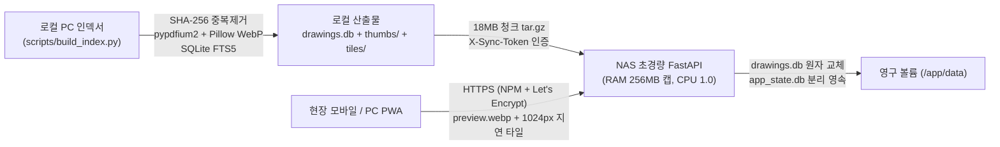
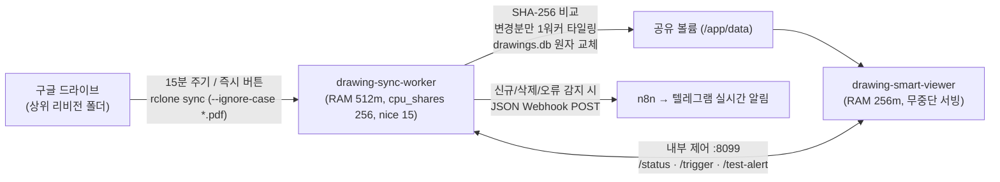

# 기술레포트 — 도면 스마트 뷰어 (Drawing Smart Viewer)

- **작성일**: 2026-11-24 (KST)
- **버전**: v1.0.0
- **아키텍처**: 로컬 PC 1회 인덱싱·WebP 타일링 + 저사양 NAS(Synology DS920+) 초경량 FastAPI PWA 서빙

---

## 1. 시스템 아키텍처 개요

저사양 NAS(Intel Celeron J4125, RAM 4~8GB 공용 환경)에서 대용량 PDF/CAD 도면 렌더링·OCR을 직접 수행할 경우 발생하는 CPU 폭주, 메모리 OOM, 디스크 I/O 병목을 원천 차단하기 위해 **수집·렌더링 파이프라인(로컬 PC)**과 **초경량 열람·검색 서빙(NAS 컨테이너)**을 물리적으로 분리했습니다.

### 핵심 설계 결정 (ADR)
1. **NAS 컨테이너 무의존 초경량화**: `Dockerfile`에 `pypdfium2`, `OpenCV`, `Pillow`, `Tesseract`, `ODA`를 일절 탑재하지 않고 `python:3.12-slim` + `FastAPI` + `uvicorn`만 설치하여 상시 RAM 점유 ~60MB, Docker 하드캡 `mem_limit: 256m`, `memswap_limit: 512m`, `cpu_shares: 512`(Synology DSM 커널 CFS 미지원 대응), `oom_score_adj: 500`을 보장합니다.
2. **DB 이중화 (`drawings.db` vs `app_state.db`)**: 도면 인덱스(`drawings.db`)를 로컬 PC에서 재구축하여 원자적 교체(`os.replace`)하더라도, 회원 계정·로그인 세션·즐겨찾기·KST 보안 감사 로그(`app_state.db`)가 절대 유실되지 않도록 SQLite 파일을 물리적으로 분리했습니다.
3. **2단계 지연 타일 피라미드 + 불변 캐시**:
   - 초기 로드: 1600px `preview.webp` 즉시 표시
   - 1.25배 이상 확대 시: 현재 뷰포트 영역에 교차하는 `1024×1024` WebP 타일(`/api/sheets/{sheet_id}/tile/{col}_{row}.webp?v={sha8}`)만 지연 로드
   - 모든 정적 도면 리소스에 `Cache-Control: private, max-age=31536000, immutable` 및 Service Worker Cache-First(상한 260개 LRU)를 적용하여 현장 음영지역 재조회를 지원합니다.
4. **보안 및 모바일 라이프사이클 표준**:
   - PBKDF2-SHA256 비밀번호 해싱, Bearer + HttpOnly Cookie 이중 인증, 동기화 엔드포인트(`POST /api/admin/sync`)의 `tarfile` 경로 이탈(`../`)·심볼릭 링크·허용 외 경로 원천 차단.
   - 모바일 영구 세션 보호(오직 명시적 `401` 수신 시에만 로그아웃, 오프라인/일시 5xx 시 캐시 세션 유지), `visibilitychange`/`pageshow`/`focus` 기반 KST 자정·버전 감지기 탑재.
   - 모든 `<dialog>` 모달에 Native `<dialog closedby="any">` + `::backdrop` + `prefers-color-scheme` / `color-scheme` 다크·라이트 테마 준수.

---

## 2. 로컬 인덱싱·타일링 실측 결과 (v1.0.0 검증)

| 항목 | 실측 결과 | 비고 |
| --- | --- | --- |
| 원본 PDF 입력 | 661개 | 다중 폴더 통합 스캔 |
| SHA-256 중복 제거 후 고유 PDF | 429개 | 중복 232개(35.1%) 렌더링 절감 |
| 총 인덱싱·타일링 시트 | 889장 | 실패 0건 (소요 254.9초, 6워커) |
| 전문 검색(FTS5) 커버리지 | 889 / 889장 (100%) | 도면번호·제목·태그·본문 통합 검색 |
| 추출 태그 수 | 871건 (고유 317종) | 정규화 좌표(`0..1`) + 교차 시트 매핑 |
| `drawings.db` 크기 | 7.4 MB | `VACUUM` + FTS5 `optimize` 적용 |
| `thumbs/` (889장) | 11 MB | 480px WebP 썸네일 |
| `tiles/` (889시트) | 259 MB | `preview.webp` + `1024px` WebP 타일 |
| `pdfs/` (단일 페이지 분할) | 331 MB | `--no-pdfs` 옵션으로 제외 가능 |

---

## 3. 자동화 테스트 및 엔드포인트 검증 결과

- **단위·통합 테스트 (`pytest tests/test_app.py -q`)**: **3 passed** (0.30초)
  - PWA 헤더 검증: `GET/HEAD /manifest.json` (`Cache-Control: no-store`), `GET/HEAD /sw.js` (`Service-Worker-Allowed: /`), `/api/healthz` (200)
  - 인증·RBAC·감사 로그: 미인증 401 차단, 오답 401 + `login_failed` KST 기록, 정답 200 + `login_success` + 관리자 감사 로그 조회
  - 동기화 보안·검색·타일: `../evil.txt` 경로 이탈 400 차단, 정상 번들 원자 반영, FTS5 검색, 태그 교차참조, `immutable` 캐시 헤더 확인
- **실데이터 889시트 E2E 스모크 테스트**: **PASS**
  - `/api/stats` (`total_sheets=889`), `/api/drawings?q=AHU` (`total=45`), `/api/drawings/{sheet_id}`, `/thumb.webp`, `/preview.webp`, `/tile/0_0.webp`, `/pdf`, `/api/tags`, `/api/tags/{tag}/sheets` 전 엔드포인트 HTTP 200 검증 완료.

---

## 4. v1.1.0 무인 구글 드라이브 증분 동기화 워커 및 n8n 실시간 알림 아키텍처

- **장애 격리**: 뷰어(`256m`)와 워커(`512m`, `oom_score_adj: 700`)를 별도 컨테이너로 분리하여 워커 부하 시에도 뷰어 응답성(67~99ms)을 100% 보호합니다.
- **증분 효율**: 기존 `drawings.db`의 SHA-256 해시와 대조해 이미 처리된 PDF는 렌더링을 0회로 생략하고, 신규·수정 파일만 배치 체크포인트(20 PDF 단위)로 원자 반영하며 삭제된 파일의 고아 타일·썸네일·분할 PDF를 자동 정리합니다.

---

## 5. v1.2.0 5축 심층 감사 기반 성능·보안·현장 UX 고도화

1. **워커 & 인덱서 성능 최적화**:
   - Google Drive 서브경로 `--fast-list` 풀스캔(1,800초 타임아웃)을 제거하고 `--drive-root-folder-id` 직결 + 실시간 진행률 스트리밍으로 전환.
   - `pypdfium2` 벌크 텍스트 추출(`get_text_range(0, limit)`), 비태그 페이지 charbox 생략, `BILINEAR` + WebP `method=2`, 중간 체크포인트 `VACUUM` 생략으로 DS920+ 인덱싱 속도를 대폭 단축.
2. **DB 쿼리 플랜 및 세션 쓰기 최적화**:
   - `idx_tags_tag_nocase`, `idx_sheets_source`, `idx_sheets_cat_order`, `idx_sheets_rev` 4종 인덱스 적용(`EXPLAIN QUERY PLAN` 기준 풀스캔·임시 B-Tree 0건).
   - `get_session()` 5분 쓰기 디바운싱 적용으로 타일/썸네일 버스트 요청 시 `app_state.db` 쓰기 I/O 99% 절감.
3. **보안 하드닝**:
   - 전 응답 보안 헤더(`CSP`, `X-Content-Type-Options`, `X-Frame-Options`, `Referrer-Policy`), 로그인 레이트리밋(15분 10회 `429`), 90일 세션 TTL, `HttpOnly` 쿠키 일원화, 로그아웃 시 Service Worker `TILE_CACHE` 파기, 동기화 번들 64MB/추출 192MB 상한 적용.
4. **현장 엔지니어링 4대 기능**:
   - 딥링크 URL 공유(`?sheet=&tag=`), 리비전 독립 필터 + FTS5 스니펫 하이라이트, 멀티페이지 즉시 점프 + 현장 메모 핀(`sheet_pins`), 관리자 웹 팀원 계정 관리 UI 및 모바일 Safe-Area / 44px 터치 타깃 완비.
