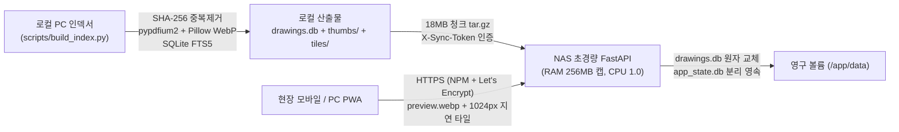
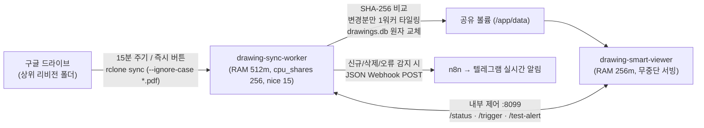

# 기술레포트 — 도면 스마트 뷰어 (Drawing Smart Viewer)

- **작성일**: 2026-11-26 (KST)
- **버전**: v1.4.0
- **아키텍처**: 로컬 PC / 증분 워커 인덱싱·WebP 타일링·선택적 2-Pass 400 DPI ROI OCR + 저사양 NAS(Synology DS920+) 초경량 FastAPI PWA 서빙

---

## 1. 시스템 아키텍처 개요

저사양 NAS(Intel Celeron J4125, RAM 4~8GB 공용 환경)에서 대용량 PDF/CAD 도면 렌더링·OCR을 직접 수행할 경우 발생하는 CPU 폭주, 메모리 OOM, 디스크 I/O 병목을 원천 차단하기 위해 **수집·렌더링 파이프라인(로컬 PC)**과 **초경량 열람·검색 서빙(NAS 컨테이너)**을 물리적으로 분리했습니다.

### 핵심 설계 결정 (ADR)
1. **NAS 컨테이너 무의존 초경량화**: `Dockerfile`에 `pypdfium2`, `OpenCV`, `Pillow`, `Tesseract`, `ODA`를 일절 탑재하지 않고 `python:3.12-slim` + `FastAPI` + `uvicorn`만 설치하여 상시 RAM 점유 ~60MB, Docker 하드캡 `mem_limit: 256m`, `memswap_limit: 512m`, `cpu_shares: 512`(Synology DSM 커널 CFS 미지원 대응), `oom_score_adj: 500`을 보장합니다.
2. **DB 이중화 (`drawings.db` vs `app_state.db`)**: 도면 인덱스(`drawings.db`)를 로컬 PC에서 재구축하여 원자적 교체(`os.replace`)하더라도, 회원 계정·로그인 세션·즐겨찾기·KST 보안 감사 로그(`app_state.db`)가 절대 유실되지 않도록 SQLite 파일을 물리적으로 분리했습니다.
3. **2단계 지연 타일 피라미드 + 불변 캐시**:
   - 초기 로드: 1600px `preview.webp` 즉시 표시
   - 1.25배 이상 확대 시: 현재 뷰포트 영역에 교차하는 `1024×1024` WebP 타일(`/api/sheets/{sheet_id}/tile/{col}_{row}.webp?v={sha8}`)만 지연 로드
   - 모든 정적 도면 리소스에 `Cache-Control: private, max-age=31536000, immutable` 및 Service Worker Cache-First(상한 260개 LRU)를 적용하여 현장 음영지역 재조회를 지원합니다.
4. **보안 및 모바일 라이프사이클 표준**:
   - PBKDF2-SHA256 비밀번호 해싱, Bearer + HttpOnly Cookie 이중 인증, 동기화 엔드포인트(`POST /api/admin/sync`)의 `tarfile` 경로 이탈(`../`)·심볼릭 링크·허용 외 경로 원천 차단.
   - 모바일 영구 세션 보호(오직 명시적 `401` 수신 시에만 로그아웃, 오프라인/일시 5xx 시 캐시 세션 유지), `visibilitychange`/`pageshow`/`focus` 기반 KST 자정·버전 감지기 탑재.
   - 모든 `<dialog>` 모달에 Native `<dialog closedby="any">` + `::backdrop` + `prefers-color-scheme` / `color-scheme` 다크·라이트 테마 준수.

---

## 2. 로컬 인덱싱·타일링 실측 결과 (v1.0.0 검증)

| 항목 | 실측 결과 | 비고 |
| --- | --- | --- |
| 원본 PDF 입력 | 661개 | 다중 폴더 통합 스캔 |
| SHA-256 중복 제거 후 고유 PDF | 429개 | 중복 232개(35.1%) 렌더링 절감 |
| 총 인덱싱·타일링 시트 | 889장 | 실패 0건 (소요 254.9초, 6워커) |
| 전문 검색(FTS5) 커버리지 | 889 / 889장 (100%) | 도면번호·제목·태그·본문 통합 검색 |
| 추출 태그 수 | 871건 (고유 317종) | 정규화 좌표(`0..1`) + 교차 시트 매핑 |
| `drawings.db` 크기 | 7.4 MB | `VACUUM` + FTS5 `optimize` 적용 |
| `thumbs/` (889장) | 11 MB | 480px WebP 썸네일 |
| `tiles/` (889시트) | 259 MB | `preview.webp` + `1024px` WebP 타일 |
| `pdfs/` (단일 페이지 분할) | 331 MB | `--no-pdfs` 옵션으로 제외 가능 |

---

## 3. 자동화 테스트 및 엔드포인트 검증 결과

- **단위·통합 테스트 (`pytest tests/test_app.py -q`)**: **3 passed** (0.30초)
  - PWA 헤더 검증: `GET/HEAD /manifest.json` (`Cache-Control: no-store`), `GET/HEAD /sw.js` (`Service-Worker-Allowed: /`), `/api/healthz` (200)
  - 인증·RBAC·감사 로그: 미인증 401 차단, 오답 401 + `login_failed` KST 기록, 정답 200 + `login_success` + 관리자 감사 로그 조회
  - 동기화 보안·검색·타일: `../evil.txt` 경로 이탈 400 차단, 정상 번들 원자 반영, FTS5 검색, 태그 교차참조, `immutable` 캐시 헤더 확인
- **실데이터 889시트 E2E 스모크 테스트**: **PASS**
  - `/api/stats` (`total_sheets=889`), `/api/drawings?q=AHU` (`total=45`), `/api/drawings/{sheet_id}`, `/thumb.webp`, `/preview.webp`, `/tile/0_0.webp`, `/pdf`, `/api/tags`, `/api/tags/{tag}/sheets` 전 엔드포인트 HTTP 200 검증 완료.

---

## 4. v1.1.0 무인 구글 드라이브 증분 동기화 워커 및 n8n 실시간 알림 아키텍처

- **장애 격리**: 뷰어(`256m`)와 워커(`512m`, `oom_score_adj: 700`)를 별도 컨테이너로 분리하여 워커 부하 시에도 뷰어 응답성(67~99ms)을 100% 보호합니다.
- **증분 효율**: 기존 `drawings.db`의 SHA-256 해시와 대조해 이미 처리된 PDF는 렌더링을 0회로 생략하고, 신규·수정 파일만 배치 체크포인트(20 PDF 단위)로 원자 반영하며 삭제된 파일의 고아 타일·썸네일·분할 PDF를 자동 정리합니다.

---

## 5. v1.2.0 5축 심층 감사 기반 성능·보안·현장 UX 고도화

1. **워커 & 인덱서 성능 최적화**:
   - Google Drive 서브경로 `--fast-list` 풀스캔(1,800초 타임아웃)을 제거하고 `--drive-root-folder-id` 직결 + 실시간 진행률 스트리밍으로 전환.
   - `pypdfium2` 벌크 텍스트 추출(`get_text_range(0, limit)`), 비태그 페이지 charbox 생략, `BILINEAR` + WebP `method=2`, 중간 체크포인트 `VACUUM` 생략으로 DS920+ 인덱싱 속도를 대폭 단축.
2. **DB 쿼리 플랜 및 세션 쓰기 최적화**:
   - `idx_tags_tag_nocase`, `idx_sheets_source`, `idx_sheets_cat_order`, `idx_sheets_rev` 4종 인덱스 적용(`EXPLAIN QUERY PLAN` 기준 풀스캔·임시 B-Tree 0건).
   - `get_session()` 5분 쓰기 디바운싱 적용으로 타일/썸네일 버스트 요청 시 `app_state.db` 쓰기 I/O 99% 절감.
3. **보안 하드닝**:
   - 전 응답 보안 헤더(`CSP`, `X-Content-Type-Options`, `X-Frame-Options`, `Referrer-Policy`), 로그인 레이트리밋(15분 10회 `429`), 90일 세션 TTL, `HttpOnly` 쿠키 일원화, 로그아웃 시 Service Worker `TILE_CACHE` 파기, 동기화 번들 64MB/추출 192MB 상한 적용.
4. **현장 엔지니어링 4대 기능**:
   - 딥링크 URL 공유(`?sheet=&tag=`), 리비전 독립 필터 + FTS5 스니펫 하이라이트, 멀티페이지 즉시 점프 + 현장 메모 핀(`sheet_pins`), 관리자 웹 팀원 계정 관리 UI 및 모바일 Safe-Area / 44px 터치 타깃 완비.

---

## 6. v1.3.0 초고속 부분검색 · 선택적 한국어 OCR · 계기/배관/연결화살표 3원 추적

1. **차세대 플랜트 태그·배관·밸브·연결 화살표 파서 (`scripts/build_index.py`)**:
   - 언더스코어 계기/설비 태그(`TIC_N2USHCW31`, `AHU_N2US0101`, `ICGP_N2GC0202B`), 플랜트 하이픈 태그(`MCC-NK2U1B4-A`), 6자리 배관 라인(`550A-CWR-061213-A1X` → 구경/유체/일련번호/스펙 구조화), 수동·인라인 밸브(`*BFV-006R08`), 2~3줄 영숫자 원형·사각 버블 자동 결합, Off-Page `FR/TO` 도면 간 연결 화살표(`continuations`) 추출 구현.
   - `canonical_tag`(`_`↔`-` 통합) 및 `loop_key` 도입으로 공종 간 표기 차이를 해소하고 동일 루프·배관 패밀리 묶기 지원.
2. **선택적 하이브리드 RapidOCR 파이프라인 (`scripts/ocr_engine.py`, `Dockerfile.worker`)**:
   - 디지털 텍스트가 정상 존재하는 83% 도면은 즉시 건너뛰고(`needs_ocr=False`), 표제란 상용구·`'M'` 더미만 남은 SHX/스캔 도면(17%)에만 `korean_PP-OCRv5` 모바일 + `PP-OCRv4` 검출 ONNX 모델(총 `17.4MB`, 빌드 시 오프라인 프리워밍)을 가동.
   - `1280×1280` (`180px` 오버랩) 슬라이딩 창 + 빈 여백 스킵 + 경계 절단 배제 NMS + 동일 시트 확정 설비사전 기반 가중 편집거리 퍼지 보정(`snap_ocr_token`).
   - DS920+ 워커(`mem_limit: 768m`)에서는 격리 서브프로세스로 단발 실행하여 완료 즉시 ONNX Runtime RAM을 OS에 전량 반환하며, 웹 뷰어(`drawing-smart-viewer`, `256m`)에는 OCR 패키지를 일절 탑재하지 않아 런타임 응답 속도 `0ms` 손실 보장.
3. **초고속 하이브리드 검색 & 3원 입체 추적 UI (`backend/db.py`, `backend/main.py`, `frontend/`)**:
   - SQLite `FTS5 trigram` 가상 테이블(`sheets_trigram`) + `FTS5 unicode61` + `canonical_tag` 하이브리드 검색으로 `61213`, `AHU0301`, `무기통합` 같은 중간 부분 문자열도 `< 5ms` 내 검색 + 폴백 `[[H]]` 스니펫 제공.
   - 도면 위 개체별 색상 오버레이(계기 파랑 · 배관 초록 · 설비 보라 · 밸브 노랑 · 연결 화살표 주황 점선), 공종 흐름 정렬(`P&ID → HCD → WRP → EQP → MCW → 전력제어 → SHOP`), 동일 루프/배관 패밀리 칩, Off-Page 유출/유입 연결 화살표 원클릭 점프 구현.

---

## 7. v1.3.1 보안·동기화·DB·워커 하드닝 및 모바일 좌측 메뉴 스크롤 오류 수정

1. **인증·세션·프록시 보안 하드닝 (`backend/db.py`, `backend/main.py`, `Dockerfile`)**:
   - **XFF 스푸핑 원천 차단**: `_client_ip()`의 수동 `X-Forwarded-For` 좌측 파싱을 제거하고 Uvicorn `--proxy-headers --forwarded-allow-ips=127.0.0.1,172.16.0.0/12,192.168.0.0/16`의 검증된 `request.client.host`만 신뢰.
   - **DoS 안전 레이트 리밋 & 메모리 상한**: `ip` 및 `(ip, username)` 복합 키 차단(429)과 `MAX_RATE_LIMIT_KEYS=2048` 자동 정리를 적용하고, 타 IP의 동일 계정 실패가 정상 IP 관리자를 잠그지 않도록 분리(임계 초과 시 유한 지연 + 감사 기록).
   - **타이밍 공격 방어 & 세션 토큰 해시화 + 60초 캐시**: 미존재 아이디에도 사전 생성된 더미 해시로 동일 비용 PBKDF2를 수행하고, `sessions.token`에 평문 대신 SHA-256 해시만 저장(구버전 평문 세션은 첫 조회 시 무중단 자동 해시 승격). 60초 bounded 인메모리 캐시(`MAX_SESSION_CACHE=512`)를 도입하되 로그아웃·계정 삭제·비밀번호 로테이션 시 즉시 무효화.
2. **SQLite 읽기 전용 분리 · 동기화 원자성/스트리밍 · 검색 10배 가속**:
   - **`DELETE` 저널 + `mode=ro` 분리**: `drawings.db`는 모든 쓰기 경로(`init_drawings_db`, `drawings_write_conn`)에서 `PRAGMA journal_mode=DELETE`를 유지하고, 일반 조회(`drawings_conn`)는 `file:...?mode=ro` 순수 읽기 전용으로 열어 `-wal`/`-shm` 잔존 및 읽기 전용 볼륨 충돌을 원천 차단.
   - **스트리밍 2단계 동기화(`POST /api/admin/sync`)**: `run_in_threadpool` + `_sync_upload_lock` 직렬화로 이벤트 루프 블로킹과 동시 업로드 충돌을 제거하고, `bundle.file` 직접 스트리밍으로 업로드 피크 RAM을 `64MB → ~1MB`로 절감. Phase 1 전 멤버 보안·용량 사전 검증 후 Phase 2에서 에셋 먼저 원자 기록, `./drawings.db` 정규화 후 DB를 최후미 원자 교체.
   - **검색 최적화 & `LIKE` 이스케이프**: `sheets_trigram` 존재 시 50ms 중복 풀스캔(`tags LIKE '%...%'`)을 제거하고 `canonical_tag`/`loop_key` 인덱스 직결 + `_escape_like()`(`ESCAPE '\'`) 적용으로 실데이터(77,093태그) 검색 지연을 `55ms → 5.2~13.8ms`로 단축.
3. **워커 대량 삭제 안전장치 · 공급망 고정 & 모바일 좌측 사이드바 스크롤 수정**:
   - `worker/sync_worker.py`(`rclone --max-delete 50`) 및 `scripts/build_index.py`(`max_delete_ratio=0.30`, 10개 이상 시 30% 초과 삭제 즉시 중단 + n8n 오류 알림) 이중 안전장치 구축.
   - `.dockerignore`의 `scripts/` 제외 버그 해소, `Dockerfile` 비루트 `appuser(1000)` 일원화, `requirements.txt`·`requirements-worker.txt` 정확한 검증 버전 고정 및 FastAPI `0.128.8`의 `GET /api/tags` `func` 인자명 충돌(`tag_func`, `alias="func"`) 해소.
   - **모바일 좌측 메뉴 스크롤 오류 수정 (`frontend/static/style.css`, `app.js`)**: `<= 900px` 모바일에서 다수 리비전/카테고리/세부공종 칩 확장 시 하단이 가려지고 스크롤되지 않던 Flexbox 높이 초과 결함을 단일 터치 스크롤 `.sidebar`(`overflow-y: auto`, `overscroll-behavior: contain`, `touch-action: pan-y`) + 상단 고정 `.sidebar-tabs` + `100dvh`/Safe-Area 하단 여백 구조로 근본 해결.
4. **자동화 검증 결과**:
   - `pytest tests/test_app.py -v` (Python 3.12.16, `fastapi==0.128.8`): **13 passed / 0 failed**.
   - `node --check frontend/static/app.js && node --check frontend/static/sw.js`: **PASS**.
   - 시크릿·민감정보 유출 전수 스캔: **0건 (`SECRET_SCAN_CLEAN`)**.

---

## 8. v1.4.0 2-Pass 400 DPI ROI 재OCR · 하이브리드 SHX 복구 · 불변제약 전역 사전 교정

1. **2중 게이트 본문 전용 하이브리드 OCR 감지 (`scripts/ocr_engine.py`)**:
   - 우하단 표제란(`x >= 0.48, y >= 0.72`)을 제외한 순수 도면 본문 유효 토큰(`< 12`)과 PDFium 객체 타입(`FPDF_PAGEOBJ_PATH >= 200` 또는 `FPDF_PAGEOBJ_IMAGE` 면적 `>= 25%`)을 교차 검사하는 `needs_body_ocr()` 구현.
   - 단순 디지털 표지(벡터 선분 `< 200`)의 불필요한 OCR을 0.1ms 만에 배제하고, 표제란만 디지털이면서 본문이 SHX 벡터인 숨은 도면(도면목록·결선·P&ID 등)을 자동 복구. 디지털/OCR 중복 박스는 `merge_digital_and_ocr_words()`(`IoU >= 0.35`)로 제거.
2. **Pass 2 Adaptive 400 DPI ROI 부분 크롭 재OCR & 세로 Y축 분할**:
   - A1 풀렌더링(RAM 200MB+) 대신 Pass 1(3400px)에서 검출된 저신뢰도 영숫자 태그 후보(`conf < 0.86`, 페이지당 최대 14 ROI)만 `pypdfium2` 네이티브 `page.render(scale=<=5.5, crop=...)`로 ~400 DPI 부분 렌더링(크롭당 `< 2.7MB` RAM, 8 ROI 합산 `0.01초`).
   - 단순 문자열 `join` 병합 대신 개별 검출 박스를 페이지 정규화 좌표로 역투영 교체(`refine_low_conf_rois`)해 인접 버블·기호 오염을 차단하고, RapidOCR 내장 방향 분류기를 활용하면서 `rotated=True` 복수 토큰에 `Y`축 비례 분할을 추가(`0ms`).
3. **3대 불변 제약 전역 사전 교정 · OCR JSON 캐시 · 경량 표 행 복원 (`scripts/build_index.py`, `worker/sync_worker.py`)**:
   - 말미 숫자 슬롯 `O→0`/`I,l→1` 결정론적 정규화(`CO2`/`NO2`/`SO2`/`H2O` 보호) + 디지털 확정 사전 기반 전역 스냅(`snap_global_ocr_tags`)에 **기능문자(`DPIT`/`DPT`/`DPI`) 불변 · 동/존/호기/트레인/길이 불변 · 엄격 시각 혼동쌍(`<=2자`) 유일 일치** 3대 제약을 강제하여 공학적 오교정 0건 보장.
   - 페이지별 원시 OCR JSON 캐시(`ocr_cache/{sha16}_p{no}_v2.json`, 워커는 `WORKER_STATE_DIR/ocr_cache` 분리 저장)로 전체 1,932장 재파싱 시간 **24.3초** 달성.
   - 추가 ML 의존성(`0MB`) 없이 단어 좌표 `(x0, y0)` Y-행 클러스터링(`reconstruct_row_text`)으로 데이터시트·일람표의 `|` 구분 행/열 문맥 검색 지원.
4. **실데이터(1,932장) 전후 검증 결과**:
   - OCR 완료 시트: `284 → 324장`(**+40장** 숨은 하이브리드 SHX 복구, `failed=0`), 도면번호 미인식 `-12장` 복구.
   - 저신뢰도 OCR 태그: `< 0.75` **`153 → 14건` (-90.8%)**, `< 0.85` **`561 → 150건` (-73.3%)**.
   - 추출 태그 `77,093 → 77,576건`(**+483건**), 도면 간 연결 화살표 `4,087 → 4,177건`(**+90건**), 불변제약 전역 사전 교정 **425건**(기능문자 변조 0건).
   - `pytest tests/test_app.py -q` (Python 3.12.16): **14 passed / 0 failed**.
